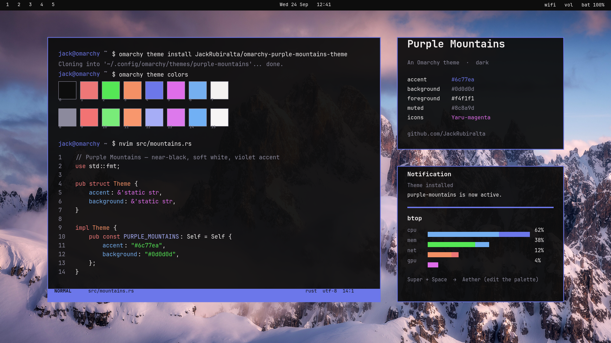

# Purple Mountains

A dark [Omarchy](https://omarchy.org) theme: near-black surfaces, soft white text and a violet-blue accent lifted from the purple-mountains wallpaper. Built with Aether, packaged as a standalone theme.



## Install

```sh
omarchy theme install https://github.com/JackRubiralta/omarchy-purple-mountains-theme
```

Or in Omarchy: **Super + Space → Install → Style → Theme** and paste the URL above. The theme shows up as **purple-mountains** in the theme switcher.

## Palette

| Role | Hex | | Role | Hex |
|---|---|---|---|---|
| background | `#0d0d0d` | | accent | `#6c77ea` |
| foreground | `#f4f1f1` | | selection | `#2c3040` |
| muted | `#8c8a9d` | | lighter background | `#24242e` |
| red | `#ee7777` | | bright red | `#f48f8f` |
| green | `#6fdd7f` | | bright green | `#8de89a` |
| yellow | `#f2cc7a` | | bright yellow | `#f6d78f` |
| blue | `#6c77ea` | | bright blue | `#a6adf6` |
| magenta | `#df6dea` | | bright magenta | `#e58cf0` |
| cyan | `#72bdf0` | | bright cyan | `#8ac9f4` |
| orange | `#f39065` | | brown | `#915353` |

Everything else (terminals, btop, Neovim via aether.nvim, the Omarchy shell, Hyprland borders, Chromium, VS Code, Obsidian, …) is generated by Omarchy from `colors.toml`.

## Optional: glass mode (window transparency)

Omarchy doesn't let a git-installed theme change Hyprland settings, so window transparency is a small snippet you add yourself. Paste it at the end of `~/.config/hypr/looknfeel.lua`. Hyprland reloads when you save.

| Group | Apps | While using it | Clicked away |
|---|---|---|---|
| Terminals | Ghostty, Alacritty, kitty, foot, WezTerm, btop and Omarchy's other terminal windows | 87.5 % | 80 % |
| Selected apps | The apps Omarchy marks as transparent: Nautilus, omawrite, 1Password (if installed), and any window you turn see-through with **Super + Backspace** | 98.5 % | 92.5 % |
| All other apps | Browsers, video players, games, Steam, chat apps, … | 100 % | 100 % |

```lua
-- Glass mode: "<while using it> <clicked away>" for each group.
-- Later rules win, so keep this order.
o.window({ class = ".*", title = ".*" }, { opacity = "1.0 1.0" })                               -- all other apps
o.window({ class = ".*", title = ".*", tag = "transparent-window" }, { opacity = "0.985 0.925" }) -- selected apps
o.window({ class = ".*", title = ".*", tag = "terminal" }, { opacity = "0.875 0.8" })            -- terminals
```

To add an app to the selected group, put `o.transparent_window("org.gnome.TextEditor")` above the snippet (find the class with `hyprctl clients`). For a frosted look, also pick **Glassy** in Omarchy's **Appearance → Windows → Window Opacity** menu. The snippet needs Omarchy 4 or newer.

## What's inside

```
colors.toml          palette (Omarchy 4 semantic format)
icons.theme          Yaru-magenta
keyboard.rgb         keyboard backlight colour for supported laptops (accent)
backgrounds/         1-purple-mountains.jpg (the wallpaper), omarchy.webp (plain branded wallpaper in the palette)
unlock.png           lock-screen / boot-splash wordmark in the accent colour
preview.png          shown in the theme switcher and on themes.omarchy.org
preview-unlock.png   boot-splash thumbnail for the Plymouth unlock-screen switcher (generated with `omarchy plymouth preview`)
gtk.css              libadwaita named colours for GTK apps
```

Terminal configs, Neovim and VS Code are generated by Omarchy from `colors.toml` on install, so this repo does not ship them (Omarchy drops those files from git-installed themes anyway).

## Requirements

Omarchy 4 (Quattro) or newer. The theme is a `colors.toml` palette, which Omarchy 3 does not read.

## License and credits

Theme files are MIT licensed (see `LICENSE`). Wallpaper, wordmark and icon attributions are in [CREDITS.md](CREDITS.md).
